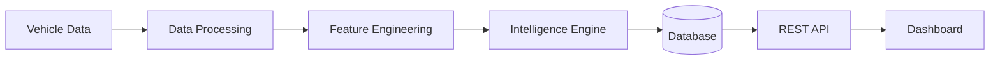

# AI Service Architecture

> **Status: design proposal.** RFIE as delivered is rule-based. **No machine-learning model has been trained, evaluated or deployed.** This document describes how AI services could be added later for ReVithalize's fleet of retrofitted electric motorcycles and scooters.

## Architecture diagram



```
Vehicle Data -> Data Processing -> Feature Engineering -> Intelligence Engine -> Database -> REST API -> Dashboard
```

| Stage | Today (implemented) | Future AI extension |
|-------|--------------------|---------------------|
| Vehicle Data | Synthetic EV generator | Battery management system (BMS) logs, telematics, charging records, service history |
| Data Processing | Pandas cleaning, type checks | Validation, missing-value handling, unit checks (kWh, km, ₹) |
| Feature Engineering | Ratios to type benchmarks, per-year rates, charge cycles | Rolling windows, battery-fade trends, temperature and charging-pattern features |
| Intelligence Engine | Rule-based scoring and recommendations | Trained models behind the same interface |
| Database | SQLite tables | Prediction tables with model version and timestamp |
| REST API | FastAPI endpoints | New `/api/predictions/...` endpoints |
| Dashboard | KPIs, tables, alerts | Forecast and prediction views |

The existing `score_vehicle()` function is the integration point: a model can replace or sit beside a rule, and the rest of the pipeline stays unchanged.

## 1. Vehicle Health Prediction (battery-centred)

| Item | Proposal |
|------|----------|
| Goal | Predict battery health (and overall health score) 3–6 months ahead, or the chance a vehicle drops below 70 % battery health |
| Model | Random Forest (regressor / classifier) |
| Inputs | Battery health history, charge cycles, fast-charging share, battery capacity, retrofit age, distance, utilization, motor and electrical health, breakdowns, maintenance status, vehicle type |
| Output | Predicted battery health %, or probability of reaching the replacement threshold |
| Training data | Repeated battery-health readings per vehicle over time (BMS state-of-health), at least several thousand vehicle-months |
| Metrics | MAE and R² (regression); precision, recall, F1, ROC-AUC (classification); time-based validation split |

## 2. Fleet Risk Analysis

| Item | Proposal |
|------|----------|
| Goal | Estimate the probability of a breakdown or incident in the next 30–90 days |
| Model | Gradient Boosting (e.g. scikit-learn `GradientBoostingClassifier`) |
| Inputs | Breakdown history and rate, overdue days, battery degradation, motor / electrical health, accidents, condition, usage intensity, recent cost spikes |
| Output | Risk probability 0–1 mapped to Low / Medium / High |
| Training data | Labelled event history (breakdowns and incidents with dates); rare events need enough positives or class weighting |
| Metrics | Recall at a fixed precision, PR-AUC, ROC-AUC, calibration curve, confusion matrix |

## 3. Operational Optimization

| Item | Proposal |
|------|----------|
| Goal | Assign motorcycles and scooters to routes or riders, and schedule charging, to raise utilization and cut cost |
| Method | Optimization algorithms: linear / integer programming or the Hungarian assignment algorithm; heuristics (greedy, local search) for large fleets |
| Inputs | Battery range and health, route demand, energy cost per km, charger availability, maintenance windows |
| Output | A suggested assignment and charging plan with the expected saving in ₹ |
| Data requirements | Route / job demand and charging-station data (not in the current dataset) |
| Metrics | Total cost in ₹, utilization balance, constraint violations, comparison with the current assignment |

## 4. Cost Forecasting

| Item | Proposal |
|------|----------|
| Goal | Forecast next-quarter maintenance and electricity cost (₹) per vehicle and per fleet |
| Model | Linear Regression baseline (Ridge when features are correlated) |
| Inputs | Retrofit age, planned distance, energy consumption, breakdown rate, past cost, vehicle type, season, tariff |
| Output | Forecast cost in ₹ with a prediction interval |
| Training data | At least 12–24 months of monthly cost per vehicle |
| Metrics | MAE, RMSE, MAPE against a naive "last period" baseline; rolling-origin cross-validation |

## Delivery plan

1. Replace synthetic data with real BMS, charging and service data and define labels.
2. Build the feature pipeline and a naive baseline.
3. Train the proposed model, compare it with the rule-based score on a **time-ordered hold-out set**.
4. Store predictions with model version; expose them through the API.
5. Monitor errors and retrain on a schedule.

## Cautions

- Training on this project's synthetic data would only teach a model the generator's own rules; it would demonstrate the pipeline, not real accuracy.
- The synthetic benchmarks are illustrative, not measured ReVithalize specifications.
- Models should be introduced only if they beat the transparent rule-based scores on real data.
